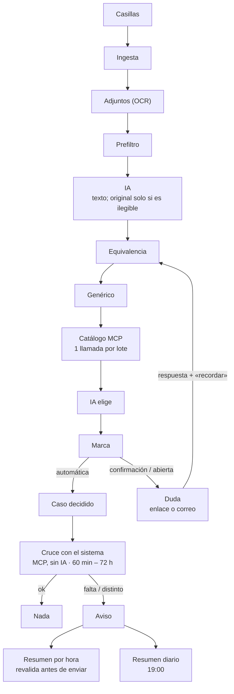

# Agente Supervisor de correos de transporte (v2)

Agente que lee los correos con instrucciones de transporte de contenedores y sus adjuntos, **usa IA solo cuando hace falta**, resuelve cada lugar contra el catálogo de un **sistema externo** (siempre por **MCP**, en lotes), pregunta a un destinatario autorizado solo lo que no entiende, **aprende** de sus respuestas y, pasada una gracia, **cruza** lo que dijo el correo con lo cargado en el sistema para avisar las diferencias que importan.

El agente es **reutilizable**: no conoce ningún sistema concreto. Todo lo externo llega por el contrato MCP descrito en [docs/mcp.md](docs/mcp.md), y la marca de los correos sale de la configuración del tenant.

---

## Documentación

- **[docs/mcp.md](docs/mcp.md)**: contrato MCP con el sistema externo. Cómo se envían los datos (un arreglo `items` con un `ref` por elemento, una sola llamada por lote) y cómo responde el servidor (un resultado por `ref`, mismo número de elementos). Es la referencia para quien implemente el servidor.
- Configuración: [variables de entorno](docs/configuracion-env.md) · [por tenant](docs/configuracion-tenant.md) · [reglas](docs/reglas.md) · [plantillas](docs/plantillas.md) · [casillas y destinatarios](docs/casillas-y-destinatarios.md) · [Gmail](docs/gmail.md) · [seguridad](docs/seguridad.md)
- Vocabulario oficial: [reglas/00_nomenclatura.md](reglas/00_nomenclatura.md) · Variables de cada correo: [plantillas/README.md](plantillas/README.md)

---

## Tabla de Contenidos

1. [El flujo v2](#1-el-flujo-v2)
2. [Niveles de decisión y acciones](#2-niveles-de-decisión-y-acciones)
3. [Conexiones externas: solo por MCP](#3-conexiones-externas-solo-por-mcp)
4. [Tareas programadas (crons)](#4-tareas-programadas-crons)
5. [Tecnologías utilizadas](#5-tecnologías-utilizadas)
6. [Requisitos](#6-requisitos)
7. [Instalación](#7-instalación)
8. [Base de datos](#8-base-de-datos)
9. [Configuración](#9-configuración) (en `docs/`)
10. [Ejecutar y ejemplos](#10-ejecutar-y-ejemplos)
11. [Estructura de carpetas](#11-estructura-de-carpetas)
12. [Módulos](#12-módulos)
13. [Migración a otras bases de datos](#13-migración-a-otras-bases-de-datos)
14. [Solución de problemas](#14-solución-de-problemas)

---

## 1. El flujo v2

| Paso | Qué ocurre | Dónde |
|---|---|---|
| **Entender** | Al llegar el correo: lee cuerpo y adjuntos (PDF hasta 2 páginas, hasta 4 imágenes). La IA extrae si es instrucción de transporte, el **flujo** (`impo`/`expo`) y las cargas. Por carga extrae los lugares tal como están escritos, en tres puntos: `inicio`, `cliente` y `final`. Si no hay contenedor ni despacho busca un booking; solo si no hay nada, pregunta | `src/Mail/`, `src/Attachments/`, `src/Understanding/` |
| **Resolver** | Cada lugar contra el catálogo del sistema externo, en este orden: equivalencia guardada → texto genérico de ciudad (no se pregunta) → coincidencia exacta o parecida → la IA elige entre candidatos → cliente con varias sedes (se verifica por marca). La IA **nunca inventa** un lugar: elige un candidato o dice «ninguno» | `src/Resolve/` |
| **Preguntar** | Solo si no entiende un lugar o la carga. Tres niveles: automático (confianza alta), confirmación de un clic (media) y duda abierta (baja). Una duda por texto; tope de 8 por corrida y 30 por día | `src/Decision/`, `src/Notify/` |
| **Aprender** | La respuesta se guarda; con «recordar» pasa a ser una equivalencia permanente (solo textos no genéricos) | `src/Pipeline/AnswerService.php`, `ndb_agent_aliases` |
| **Cruzar** | Tras **60 minutos de gracia** y hasta **72 horas**: busca la orden por contenedor, despacho o booking. Si no existe, avisa; si existe, compara cada lugar. **Sin IA**: solo un cron | `src/Check/`, `crons/agent_check.php` |
| **Avisar** | Un resumen por hora, **revalidando justo antes de enviar**: si operaciones ya cargó el dato, el aviso se descarta en silencio | `src/Notify/AlertNotifier.php`, `crons/agent_notify.php` |
| **Resumen diario** | A las 19:00 (hora del tenant) | `src/Notify/SummaryNotifier.php`, `crons/agent_summary.php` |



### Reglas de negocio para no generar ruido

- Un **lugar vacío** en el sistema solo alerta cuando ya hace falta: el `inicio` (retiro), siempre; el `cliente` (entrega), si ya hay tramos; el `final` (devolución), si ya va hacia el cliente.
- Un **texto genérico de ciudad** (San Antonio, Valparaíso, Santiago) se verifica por zona; nunca se pregunta ni se recuerda.
- Un **cliente con varias sedes** (Agrosuper, Walmart) se verifica por marca.
- Un puerto o depósito **no puede ser el «cliente»**.
- Una diferencia en un **tramo ya ejecutado** va solo al resumen diario: casi siempre es un cambio de plan posterior al correo, no un error de digitación.
- Solo «recordar» textos no genéricos: una sola respuesta equivocada guardada propaga errores. Cada equivalencia tiene `health`; si el sistema externo la contradice varias veces pasa a revisión.
- Solo se consideran **puntos activos** del catálogo.
- Reglas de dirección en `reglas/lugares.json`: «DPW» a secas es Puerto Central; «DP World CIS» es otro lugar. Equivalencias propias del cliente (por ejemplo `Hanseatic = SAAM`) van como semilla (`tools/seed_equivalences.php`).
- Todo aviso dice **qué pasó**, **de dónde sale el dato** y **qué hacer**, con el vocabulario de operaciones según el flujo ([reglas/00_nomenclatura.md](reglas/00_nomenclatura.md)).

### Cómo ahorra tokens y consultas

1. Filtro previo por remitente y prefiltro de señales (sin IA).
2. Adjuntos leídos con librerías (texto de PDF, OCR): la IA recibe texto; el original solo si es ilegible.
3. Texto limpio y recortado, instrucciones con caché del proveedor y tope diario de gasto por tenant.
4. Lo entendido se guarda (`extract_json`): al responder una duda no se vuelve a pagar la lectura.
5. **MCP por lotes**: N elementos viajan juntos en una llamada y vuelven N resultados identificados por `ref`. La resolución de lugares es 1 llamada por corrida; el cruce, ≤ 3; el aviso por hora, 1. `ndb_agent_mcp_log` permite comprobarlo.
6. Las tareas de cruce, aviso, resumen y mantenimiento **no usan IA**.

---

## 2. Niveles de decisión y acciones

| Nivel | Cuándo | Qué se hace |
|---|---|---|
| `automatica` | confianza **alta** | se acepta sin preguntar y la carga queda lista para el cruce |
| `confirmacion` | confianza **media** | duda de un clic: «¿es este?» (plantilla `duda_confirmacion`) |
| `abierta` | confianza **baja** o sin candidato | duda abierta con candidatos y texto libre (`duda_abierta`) |

Las decisiones generan **acciones** definidas en [reglas/acciones.json](reglas/acciones.json) (editable, se lee en cada corrida; cada acción queda en `ndb_agent_actions`, que la hace idempotente):

| Decisión | Condición | Acción |
|---|---|---|
| `descartar` | remitente fuera, sin señal o no es instrucción | marcar `descartado` |
| `automatica` | confianza alta | guardar caso y encolar cruce |
| `confirmacion` / `abierta` | confianza media / baja | guardar caso y crear duda |
| `carga_dudosa`, `faltante`, `dato_invalido`, `conflicto` | la IA dudó de la carga; falta un dato; dato inválido; equivalencia contradice una regla | guardar caso y crear duda |
| `limite_dudas` | tope por corrida o por día | diferir la duda |
| `respuesta_confirmar` / `respuesta_valor` | el destinatario confirma o elige | guardar equivalencia (solo con «recordar») y reprocesar |
| `respuesta_ignorar` | el destinatario ignora | ignorar el caso y reprocesar |
| `cruce_sin_orden` | no hay orden pasada la gracia | aviso `falta_en_sistema` |
| `cruce_lugar_vacio` | lugar vacío que ya hace falta | aviso `lugar_vacio` |
| `cruce_distinto` | difiere y el tramo no se ejecutó | aviso `distinto` |
| `cruce_distinto_ejecutado` | difiere pero el camión ya ejecutó el tramo | solo resumen diario |
| `cruce_ok`, `cruce_sin_verificar` | coincide, aún no hace falta o no se puede verificar | ninguna |
| `revalidado` | el sistema ya trae el dato antes de enviar | descartar el aviso en silencio |

### Tipos de duda

| `kind` | Se genera cuando | Plantilla |
|---|---|---|
| `lugar` | el texto de un lugar no se resolvió solo (confirmación o abierta) | `duda_confirmacion` / `duda_abierta` |
| `conflicto` | una equivalencia guardada contradice una regla | `duda_conflicto` |
| `carga` | la IA declaró confianza baja sobre una carga, o sobre si el correo es una instrucción | `duda_carga` |
| `faltante` | falta un dato obligatorio (`reglas/decision.json`) | `duda_faltante` |
| `dato` | contenedor con dígito verificador ISO 6346 erróneo o fecha inválida | `duda_faltante` |

Un mismo lugar se pregunta **una sola vez** aunque aparezca en varios correos.

### Cómo se responde

- **Enlace firmado de un solo uso** (vía principal): `public/index.php`. Solo responden destinatarios activos con rol `duda`. Con «recordar» (solo lugares no genéricos) la respuesta pasa a ser una equivalencia.
- **Por correo** (alternativa): los botones `mailto:` responden a `[Duda D-0012·token]` con `1`, `1 R` (y recordar), `N`, `0` o texto libre. El agente lee la respuesta en cualquiera de las casillas que ya lee (la casilla de `MAIL_REPLY_TO` debe estar entre ellas) y solo la acepta si el remitente es un destinatario `duda`.

---

## 3. Conexiones externas: solo por MCP

El agente trabaja en un ambiente separado del sistema de gestión. Toda consulta a ese sistema (catálogo de lugares, órdenes, tramos) pasa por MCP, con una regla de oro: **una llamada por lote, nunca por elemento**. Cada ítem lleva un `ref`; la respuesta devuelve exactamente un resultado por `ref`, con `status` `ok | no_encontrado | error` (un error parcial no tumba el lote).

| Herramienta | Para qué |
|---|---|
| `catalogo_lugares` | candidatos activos del catálogo para N textos de lugar |
| `buscar_ordenes` | orden y unidad por contenedor, despacho o booking |
| `tramos_de_ordenes` | tramos ejecutados de las órdenes encontradas |
| `revalidar_avisos` | revalida de una vez los avisos pendientes antes de enviarlos |

Formato de consulta, formato de respuesta, errores, límites y presupuesto de consultas por cron: **[docs/mcp.md](docs/mcp.md)**.

Siguen siendo conexiones directas (no pasan por MCP): casillas de correo (Gmail API / IMAP / carpeta de pruebas), SMTP de salida y la API de IA.

---

## 4. Tareas programadas (crons)

| Script | Frecuencia | IA | Hace |
|---|---|---|---|
| `crons/agent_ingest.php` | cada 5–15 min | sí | lee casillas, aplica respuestas por correo, entiende, resuelve lugares, decide y envía dudas |
| `crons/agent_check.php` | cada 15 min | **no** | cruza con el sistema externo (60 min de gracia, hasta 72 h) y crea avisos |
| `crons/agent_notify.php` | cada hora | **no** | resumen por hora a los destinatarios `aviso`, revalidando antes de enviar |
| `crons/agent_summary.php` | 19:00 (hora del tenant) | **no** | resumen diario a los destinatarios `resumen` |
| `crons/agent_maintenance.php` | cada 30–60 min | **no** | reabre dudas vencidas, retención, limpia originales, salud de equivalencias |
| `crons/agent_run.php` | manual | sí | corrida completa para pruebas |

Cada script toma su propio lock (una corrida a la vez por tarea). Ejemplo de crontab (mismo usuario que escribe en `logs/` y `storage/`):

```cron
*/10 * * * * cd /var/www/agente && php crons/agent_ingest.php      >> /var/log/agente.log 2>&1
*/15 * * * * cd /var/www/agente && php crons/agent_check.php       >> /var/log/agente.log 2>&1
0    * * * * cd /var/www/agente && php crons/agent_notify.php      >> /var/log/agente.log 2>&1
0   19 * * * cd /var/www/agente && php crons/agent_summary.php     >> /var/log/agente.log 2>&1
*/30 * * * * cd /var/www/agente && php crons/agent_maintenance.php >> /var/log/agente.log 2>&1
```

El resumen diario usa `summary_hour` del tenant; si el servidor está en UTC, programa el cron cada hora y el script respeta la hora local del tenant.

---

## 5. Tecnologías utilizadas

| Capa | Tecnología |
|---|---|
| Lenguaje | PHP **≥ 8.3** `declare(strict_types=1)` |
| Base de datos | **MySQL 8.x** / InnoDB / utf8mb4, acceso con **PDO** |
| Servidor web | Apache (solo expone `public/`) |
| Sistema externo | **MCP** (JSON-RPC 2.0 sobre HTTPS) con Guzzle |
| Correo de entrada | **Gmail API** (`gmail.readonly`), **IMAP** (`webklex/php-imap`) o **carpeta local** (pruebas) |
| Correo de salida | Cliente **SMTP propio**; plantillas HTML+texto en `plantillas/` |
| PDF / OCR | `smalot/pdfparser`, `pdftoppm` (poppler) y Tesseract |
| IA | API de mensajes de Anthropic vía Guzzle |
| Configuración | `symfony/dotenv` |
| Cifrado | `sodium` (`secretbox`) y HMAC-SHA256 para los enlaces |
| Pruebas | PHPUnit ^11 |

Extensiones PHP: `curl`, `intl`, `mbstring`, `pdo_mysql`, `sodium`.

---

## 6. Requisitos

- **Linux** (procedimiento para Debian/Ubuntu), **PHP ≥ 8.3**, **Composer 2**, **MySQL 8.x**, **Apache** con `mod_rewrite` y `mod_headers` (`AllowOverride All`), y `tesseract-ocr` (con español) y `poppler-utils` para PDF escaneados.

```bash
sudo apt install apache2 mysql-server composer php php-cli php-curl php-intl php-mbstring php-mysql php-xml \
                 tesseract-ocr tesseract-ocr-spa poppler-utils
sudo a2enmod rewrite headers && sudo systemctl restart apache2
```

| Qué | Para qué | ¿Obligatorio? |
|---|---|---|
| Casilla de correo (Gmail con OAuth, IMAP o carpeta) | leer instrucciones | sí |
| `ANTHROPIC_API_KEY` | entender los correos | sí para ese paso; sin ella los correos quedan en cola |
| Servidor MCP del sistema externo (`MCP_URL`, `MCP_TOKEN`) | catálogo, órdenes y tramos | sí para resolver lugares y cruzar; sin él los correos con lugares quedan en cola y no hay avisos |
| SMTP de salida | enviar dudas, avisos y resumen | sí para envío real; sin él solo hay vistas previas |
| Dominio con HTTPS | enlaces (`AGENT_BASE_URL`) | sí en producción |
| Destinatarios en `ndb_agent_recipients` (roles `duda`, `aviso`, `resumen`) | recibir y responder | sí |

---

## 7. Instalación

```bash
cd /var/www/agente
composer install                        # en producción: --no-dev
cp config/.env.example config/.env
php tools/make_keys.php                 # pegar AGENT_VAULT_KEY y AGENT_LINK_SECRET en config/.env
sudo chown -R www-data: logs storage
php tools/migrate.php                   # tablas, usuarios y permisos
php tools/db_check.php
vendor/bin/phpunit
```

Después: registrar destinatarios y casillas ([docs/casillas-y-destinatarios.md](docs/casillas-y-destinatarios.md)), sembrar equivalencias (`php tools/seed_equivalences.php --tenant=1`) y encender el tenant.

---

## 8. Base de datos

`tools/migrate.php` (repetible): crea `ndb_agent_migrations`, aplica `migrations/*.sql`, crea los usuarios `DB_AGENT_USER` (SELECT/INSERT/UPDATE solo sobre `ndb_agent_*`, sin DELETE, CREATE ni DROP) y `DB_RO_USER` (SELECT), y crea el tenant inicial **apagado** con `dry_run=1`. Necesita `DB_ADMIN_USER`/`DB_ADMIN_PASS` solo para esto.

Como el agente no puede borrar, la **retención** vacía columnas con UPDATE (cuerpo y texto de adjuntos tras `retention_days`, 90 por defecto).

| Tabla | Para qué |
|---|---|
| `ndb_agent_tenants`, `ndb_agent_config` | empresas y su configuración: `active`, `dry_run`, topes de dudas, modelo y tope de IA, vigencia del enlace, `grace_min` (60), `window_hours` (72), `notify_every_min` (60), `summary_hour` (19), `retention_days` (90), `brand_name`, `brand_footer` |
| `ndb_agent_recipients` | destinatarios con rol `duda` (decide), `aviso` (resumen por hora) o `resumen` (diario); un correo puede tener varios roles |
| `ndb_agent_mailboxes`, `ndb_agent_checkpoints` | casillas (credenciales cifradas) y posición de lectura por carpeta |
| `ndb_agent_messages` | correos y su estado; `flow`, `extract_json` (lo que entendió la IA), `result_json` |
| `ndb_agent_attachments` | adjuntos: texto extraído, validación y original solo si es ilegible |
| `ndb_agent_cases` | una fila por carga con lugares resueltos (`place_id`, método, confianza), `order_id`, `cross_state`, `cross_checked` |
| `ndb_agent_questions`, `ndb_agent_question_cases` | dudas (`kind`, `level`, `field`, `flow`, candidatos, propuesta), respuesta y casos que afectan |
| `ndb_agent_aliases` | **equivalencias**: texto normalizado → lugar (`place_id`), con `uses`, `contradictions`, `health`, `needs_review` (reemplaza a la antigua memoria) |
| `ndb_agent_alerts` | avisos del cruce (`kind`, `point`, valor del correo vs. del sistema, `sig` anti-duplicado, estado, `feedback` ✓/✗) |
| `ndb_agent_actions` | acciones ejecutadas por decisión (idempotentes) |
| `ndb_agent_mcp_log` | una fila por llamada MCP (herramienta, elementos, ms, error) |
| `ndb_agent_runs`, `ndb_agent_usage`, `ndb_agent_outbox` | corridas, consumo de IA y correos salientes (duda, aviso, resumen, respuesta) |

Estados de correo: `listo` → `procesado` | `pendiente` | `descartado` | `error`. Carga: `pendiente` → `decidido` → `cruzado` | `ignorado`. Todo el vocabulario está en [reglas/00_nomenclatura.md](reglas/00_nomenclatura.md). Fechas en **UTC** en la BD; la hora del tenant se aplica al mostrar.

---

## 9. Configuración

La configuración está separada por tema en [`docs/`](docs/):

| Documento | Qué contiene |
|---|---|
| [docs/configuracion-env.md](docs/configuracion-env.md) | todas las variables de `config/.env` (BD, llaves, URL, MCP, SMTP, IA, OCR, límites) |
| [docs/configuracion-tenant.md](docs/configuracion-tenant.md) | configuración por tenant (`ndb_agent_config`, `tools/tenant.php`): modo prueba, topes, gracia, ventana, resumen, retención, marca |
| [docs/reglas.md](docs/reglas.md) | reglas editables (`reglas/`): nomenclatura, instrucciones a la IA, `decision.json`, `acciones.json`, `lugares.json`; tabla decisión → acción |
| [docs/plantillas.md](docs/plantillas.md) | plantillas de correo y a quién llega cada una (variables en [plantillas/README.md](plantillas/README.md)) |
| [docs/casillas-y-destinatarios.md](docs/casillas-y-destinatarios.md) | casillas, roles `duda`/`aviso`/`resumen`, respuesta por enlace o correo, filtro de remitentes, equivalencias semilla |
| [docs/gmail.md](docs/gmail.md) | conectar una casilla Gmail (OAuth) |
| [docs/seguridad.md](docs/seguridad.md) | medidas de seguridad |
| [docs/mcp.md](docs/mcp.md) | **contrato MCP** con el sistema externo: formato de consulta, formato de respuesta, ahorro de consultas |

---

## 10. Ejecutar y ejemplos

```bash
php crons/agent_ingest.php       # entender, resolver, decidir, enviar dudas
php crons/agent_check.php        # cruzar con el sistema externo (sin IA)
php crons/agent_notify.php       # resumen por hora (sin IA)
php crons/agent_summary.php      # resumen diario (sin IA)
php crons/agent_maintenance.php  # reabrir dudas vencidas, retención, salud de equivalencias (sin IA)
php tools/status.php             # estado: correos, dudas, cargas, cruces, avisos, equivalencias, MCP, gasto
```

### Probar todo sin credenciales

```bash
php tools/demo.php                                   # 3 correos de ejemplo, casilla de carpeta, destinatario de prueba y storage/demo_mcp.json
php tools/seed_equivalences.php --tenant=1
php tools/tenant.php --tenant=1 --active=1
MCP_URL=fake php crons/agent_ingest.php              # MCP simulado con storage/demo_mcp.json
php tools/status.php
ls storage/outbox/                                   # vistas previas de dudas, avisos y resumen (dry_run)
```

El correo «Gracias» se descarta sin IA (`sin_senal`). Con `dry_run=1` los enlaces de las vistas previas funcionan.

### Consultas útiles

```sql
SELECT status, discard_reason, COUNT(*) FROM ndb_agent_messages GROUP BY status, discard_reason;
SELECT question_id, kind, level, field, text, status FROM ndb_agent_questions ORDER BY question_id DESC LIMIT 10;
SELECT key_norm, value, source, uses, contradictions, health FROM ndb_agent_aliases WHERE active = 1;   -- equivalencias
SELECT container, booking, state, cross_state FROM ndb_agent_cases ORDER BY case_id DESC LIMIT 10;      -- cargas y cruce
SELECT kind, status, COUNT(*), SUM(feedback = 1) ok, SUM(feedback = 0) no FROM ndb_agent_alerts GROUP BY kind, status;
SELECT tool, COUNT(*) llamadas, SUM(items) elementos FROM ndb_agent_mcp_log WHERE created >= UTC_DATE() GROUP BY tool;
SELECT SUM(cost_usd) FROM ndb_agent_usage WHERE created >= UTC_DATE();                                  -- gasto de IA hoy
```

```sql
UPDATE ndb_agent_aliases SET active = 0 WHERE key_norm = 'fruticola los andes';          -- olvidar una equivalencia
UPDATE ndb_agent_messages SET status = 'listo', tries = 0, error = NULL WHERE message_id = 123;   -- reintentar un correo en error
```

### Filtro de remitentes

| `MAIL_ALLOWED_SENDERS` | Remitente | Resultado |
|---|---|---|
| *(vacío)* | `cualquiera@x.com` | pasa |
| `cliente.cl` | `ana@cliente.cl`, `ana@sub.cliente.cl` | pasa |
| `cliente.cl` | `ana@otro.com` | descartado: `remitente` |
| *(cualquiera)* + `MAIL_DISCARD_SENDERS=avisos@x.cl` | `avisos@x.cl` | descartado: `aviso_automatico` |

### Pruebas

```bash
vendor/bin/phpunit
```

---

## 11. Estructura de carpetas

Se omiten `vendor/` y los archivos generados.

```text
www/agente/
├── .htaccess                      cierra todo el agente a la web
├── composer.json / composer.lock  autoload PSR-4 (Agente\ → src/)
├── README.md  phpunit.xml
├── docs/                          documentación
│   ├── mcp.md                     contrato MCP: formato de consulta y de respuesta, ahorro de consultas
│   ├── configuracion-env.md  configuracion-tenant.md  reglas.md  plantillas.md
│   └── casillas-y-destinatarios.md  gmail.md  seguridad.md
├── plantillas/                    correos del agente: duda_*, aviso_hora, resumen_diario, respuesta_recibida, enlace_vencido (+ README)
├── reglas/                        reglas editables
│   ├── 00_nomenclatura.md         glosario oficial
│   ├── 01_rol.md  02_campos.md  03_decisiones.md   instrucciones a la IA
│   ├── decision.json              prefiltro, confianza, obligatorios, cruce, avisos, retención, límites
│   ├── acciones.json              decisión → acción
│   └── lugares.json               genéricos y zonas, marcas, reglas de dirección, equivalencias semilla
├── config/.env.example            plantilla (el .env real no se versiona)
├── migrations/001_schema.sql      tablas ndb_agent_*
├── crons/                         agent_ingest, agent_check, agent_notify, agent_summary, agent_maintenance, agent_run
├── public/                        única carpeta accesible por web
│   ├── index.php                  responder una duda (enlace de un solo uso)
│   ├── aviso.php                  ✓/✗ de un aviso
│   ├── panel.php                  panel de solo lectura
│   └── gmail.php                  conexión OAuth de una casilla Gmail
├── tools/                         línea de comandos
│   ├── bootstrap.php  args.php  make_keys.php  migrate.php  db_check.php  status.php
│   ├── add_mailbox.php  gmail_link.php  add_recipient.php  tenant.php
│   ├── seed_equivalences.php  panel_link.php  demo.php
├── src/                           código (namespace Agente\)
│   ├── Support/  Mail/  Attachments/  Rules/  Text/  Llm/  Understanding/
│   ├── Mcp/         McpClient, HttpMcpClient, FakeMcpClient, FixtureMcp, McpLog, CatalogClient, OrdersClient
│   ├── Resolve/     PlaceResolver, Resolution, PlaceChooser, LlmPlaceChooser
│   ├── Decision/    DecisionEngine, DecisionResult, ItemResult, Doubt
│   ├── Check/       Crosschecker y reglas del cruce
│   ├── Persistence/ Messages, Cases, Questions, Aliases, Alerts, Actions, Usage, Outbox, Recipients, Mailboxes
│   ├── Notify/      Templates, QuestionMail, QuestionText, QuestionNotifier, AlertNotifier, SummaryNotifier, Mailer, SmtpMailer, FileMailer
│   └── Pipeline/    Processor, AnswerService
├── tests/                         pruebas PHPUnit
└── logs/  storage/                logs; lock, outbox/, attachments/, tmp/, demo_inbox/ (no se versionan)
```

---

## 12. Módulos

- **Support**: `Config`, `Db` (conexiones PDO: agente, solo lectura, admin), `Vault`, `LinkSigner` (enlaces de dudas) y `SignedToken` (enlaces de administración con propósito), `Lock`, `Logger`, `Proc`.
- **Mail**: `Ingestor` filtra, deduplica por Message-ID, guarda mensajes y adjuntos y avanza el checkpoint solo tras guardar el lote; detecta las respuestas a dudas (`[Duda D-0012·token]`).
- **Attachments**: texto de PDF u OCR; si no basta guarda el original para que la IA lo vea solo si lo pide. `TextSignals`/`Iso6346` validan contenedores, bookings y despachos.
- **Rules**: `RuleSet` carga `reglas/` (reglas de dirección, zonas, marcas, acciones).
- **Understanding**: `Prefilter` (sin IA), `Extractor`, `Extraction` (flujo y `inicio/cliente/final`; lee también los nombres antiguos `origen/destino`).
- **Mcp**: cliente por lotes del sistema externo, con registro de cada llamada.
- **Resolve**: `PlaceResolver` resuelve todos los lugares de la corrida con una llamada al catálogo y, si hace falta, una a la IA. Un error del sistema externo **difiere** el correo (no genera dudas).
- **Decision**: `DecisionEngine` (lógica pura) emite decisiones y dudas; cada carga declara sus decisiones para `acciones.json`.
- **Check**: cruce sin IA con las reglas de «cuándo hace falta».
- **Notify**: renderiza `plantillas/` y envía dudas, avisos por hora y resumen diario.
- **Pipeline**: `Processor` y `AnswerService` (valida la respuesta de enlace o correo, registra de forma atómica, guarda la equivalencia y reabre los correos pendientes).

---

## 13. Migración a otras bases de datos

Acceso por **PDO** con consultas preparadas. Lo específico de MySQL:

| Dónde | Dependencia | Qué cambiar |
|---|---|---|
| `Db::connect()` | DSN `mysql:`, `SET time_zone`, `SET SESSION TRANSACTION READ ONLY`, `max_execution_time` | DSN y sesión del motor nuevo |
| `UTC_TIMESTAMP()`, `UTC_DATE()`, `DATE_SUB(... INTERVAL n ...)` | funciones de fecha | equivalentes del motor |
| `ON DUPLICATE KEY UPDATE`, `INSERT IGNORE` (`Ingestor`, `Cases`, `Actions`, `Questions::link`, `Recipients`) | upsert MySQL | `ON CONFLICT ...` (PostgreSQL/SQLite) o `MERGE` |
| `IF(cond, a, b)`, `GREATEST`, `SUM(cond)` (`Messages`, `Cases`, `Aliases`, `Questions`) | funciones MySQL | `CASE WHEN ... END`, `GREATEST` |
| `migrations/001_schema.sql` | `AUTO_INCREMENT`, `ENGINE=InnoDB`, `TINYINT`, `MEDIUMTEXT`, `UNSIGNED`, índices con prefijo | tipos y sintaxis del motor |
| `tools/migrate.php`, `tools/db_check.php` | `CREATE USER`, `GRANT`, `SHOW GRANTS` | roles y permisos del motor |

Pasos: extensión PDO del motor, adaptar `Db` y `src/Persistence`, crear el esquema del motor, migrar datos, correr las pruebas y una corrida con `dry_run=1`. Los JSON se guardan como `TEXT`. MariaDB casi no requiere cambios.

---

## 14. Solución de problemas

| Síntoma | Causa probable | Solución |
|---|---|---|
| `Falta la variable de configuración X` | no existe `config/.env` o falta la clave | copiar `.env.example` y completar |
| `AGENT_VAULT_KEY ... 32 bytes` / `AGENT_LINK_SECRET ... 32 caracteres` | llaves vacías o mal copiadas | `tools/make_keys.php` |
| `SQLSTATE[HY000] [2002]` / `Access denied` | MySQL apagado, host o clave incorrectos | revisar `DB_*`; reejecutar `tools/migrate.php` |
| «Ningún tenant activo» | tenant o config apagados | `tools/tenant.php --tenant=1 --active=1` |
| La corrida no lee nada | sin casillas activas o `folders` incorrecto | revisar `ndb_agent_mailboxes` (`active`, `folders`, `last_error`) |
| Correos en `listo` que no avanzan | sin `ANTHROPIC_API_KEY`, tope diario de gasto o el sistema externo no responde (se difieren) | revisar `ndb_agent_usage` y `ndb_agent_mcp_log` (columna `error`) |
| Correo en `error` | la IA falló 3 veces o rechazó/cortó la respuesta | ver `ndb_agent_messages.error`; si fue `max_tokens`, subir `limites_ia.max_tokens_salida`; reintentar con la consulta de la sección 10 |
| Todo se descarta como `sin_senal` | el correo no tiene contenedor ni palabras clave | agregar palabras en `reglas/decision.json` → `prefiltro.palabras_clave` |
| Se pregunta demasiado | lugares sin equivalencia | `tools/seed_equivalences.php`; cada respuesta con «recordar» se guarda |
| Se pregunta algo ya respondido | la respuesta no marcó «recordar», el texto es genérico o la equivalencia está inactiva | revisar `ndb_agent_aliases.active` |
| No hay avisos | sin MCP, tenant en `dry_run`, cargas aún dentro de la gracia (60 min) o sin destinatarios `aviso` | `tools/status.php`; revisar `storage/outbox/` y `ndb_agent_recipients` |
| Llegan avisos de datos ya cargados | `revalidar_antes_de_enviar` apagado o el MCP de revalidación falla | revisar `reglas/decision.json` → `avisos` y `ndb_agent_mcp_log` |
| Equivalencia que se contradice | el sistema externo la contradijo varias veces (`needs_review`) | revisar en `panel.php` y desactivarla o corregirla |
| Las dudas no llegan | `dry_run=1` o falta `SMTP_HOST`; sin destinatarios con rol `duda` | revisar `storage/outbox/`, `ndb_agent_outbox` y `tools/add_recipient.php` |
| La respuesta por correo no se aplica | la casilla `MAIL_REPLY_TO` no está entre las que se leen o el remitente no es un destinatario `duda` | revisar la casilla de respuestas y `ndb_agent_recipients` |
| `SMTP: respuesta inesperada` | credenciales o seguridad SMTP incorrectas | revisar `SMTP_*` (`starttls` en 587, `ssl` en 465) |
| «El enlace es inválido o venció» | token vencido, ya usado, de otro propósito o `AGENT_LINK_SECRET` distinto | la duda se reenvía sola con enlace nuevo tras `link_ttl_hours`; el panel se vuelve a generar con `panel_link.php` |
| «Sin autorización» | el destinatario está inactivo o no es del tenant | revisar `ndb_agent_recipients` |
| 403 de Apache en la página pública | `.htaccess` sin efecto | `AllowOverride All`, `mod_rewrite` y `mod_headers` |
| Adjuntos con `read_method = ninguno` | sin Tesseract/poppler o `OCR_ENABLED=0` | instalar `tesseract-ocr`, `tesseract-ocr-spa` y `poppler-utils` |
| `Otra corrida en curso; salgo.` | hay otra corrida activa de ese script | esperar; el bloqueo se libera al terminar |
| Google: `redirect_uri_mismatch` | la URL de retorno no coincide | registrar exactamente la que imprime `gmail_link.php` |
| Google: `access_denied` / app no verificada | casilla no agregada como usuario de prueba | agregarla o usar consentimiento Interno |
| «Google no entregó refresh token» | la cuenta ya había autorizado la aplicación | revocar en https://myaccount.google.com/permissions y repetir |
| Gmail deja de leer a los 7 días | consentimiento Externo en modo Pruebas | pasar a Interno o publicar la aplicación y reconectar |
